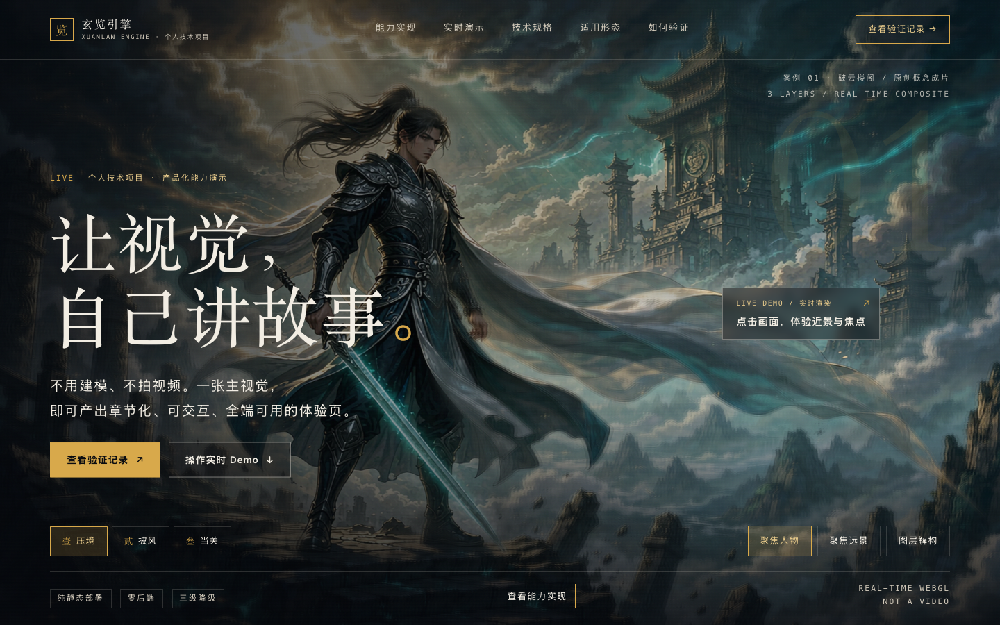

# 玄览引擎 · 产品化能力演示

> 一个个人技术项目：把实时分层合成引擎，做成一套**产品级落地页**。
> 首屏画面是引擎**实时渲染**的结果，不是截图，也不是录屏。



**项目边界声明**：这是一个面向技术评审的能力展示项目。「企业产品官网」是它的
**演示目标形态**，不是商业主体 —— 页面里没有企业名称、联系方式、客户案例、报价或服务承诺，
也不代表任何真实主体、资质或商业合作。视觉素材为本项目自行生成、未引入第三方作品；
生成平台商用条款**待确认**，仅用于个人技术演示，不作可商用表述。

代码以 MIT 许可发布，但**代码许可不等于素材授权**：`public/textures/` 与
`dist/textures/` 下的图像不在许可范围内，复用时需替换为自有权利的素材。详见 `LICENSE`。

---

## 这个项目想证明什么

打开就能验证的三件事：

1. **能做产品级成品，不只是 demo。** 8 个区块的完整信息架构：价值主张 → 痛点与解法 →
   能力模块 → 实时演示 → 技术规格 → 适用形态 → 交付结构 → 验证与复现。
   文案、排版、响应式、无 JS 降级都做到可直接给人看的完成度。
2. **首屏就是引擎在跑。** 三章节镜头、近景、双焦点、图层解构、单层查看、深度叠加
   都是运行时参数，不是预渲染视频。评审者可以直接点，状态可观测。
3. **每一条声称都能自己核查。** 213 条自动断言、三组负向用例、真实浏览器点击实测、
   逐文件资产哈希、7 张由本包 `dist/` 渲染的截图。技术规格里专门列了一行
   **「尚未实测」** —— 不把构建通过当成性能与兼容性验收通过。

还有一条是我最想展示的：**知道什么不该写**。页面没有编造企业主体、客户、资质或性能数字；
`scripts/check.mjs` 里有一条断言专门拦截虚构企业信息混入页面 —— 用自动检查守住诚实边界。

---

## 30 秒打开

**在线直接看**（无需环境）：<https://xuanlan-engine.app.workbuddy.host/?sharecode=3VXXSTBTJX>

> 托管在静态站点沙箱，首次打开约 1–2 秒；WebGL 不可用时自动退回静态成片，正文与排版始终完整。

**本地看成品**（无需 Node）：macOS 双击根目录 `预览.command`，或

```bash
cd dist
python3 -m http.server 8080 --bind 127.0.0.1
# 打开 http://127.0.0.1:8080/
```

`dist/` 是完整纯静态产物，相对路径引用、CSS 为静态 `<link>`，可直接放到任意静态服务器、
对象存储、CDN 或内网。**禁用 JavaScript 时排版、静态成片与全部正文依然完整**（实测 5256 字）。

**改源码 / 复现验证**（Node.js ≥ 22.12.0）：

```bash
npm ci
npm run check     # 213 条自动断言
npm run dev       # 开发服务器
npm run build     # 纯静态产物 → dist/
npm run preview
```

改了 `index.html` 或 CSS **必须重新 `npm run build`**，否则直接打开 `dist/` 看到的仍是旧版。

---

## 页面结构

| 区块 | 承担的作用 |
|---|---|
| 顶部导航 + 首屏 | 项目标识（明确标注「个人技术项目」）、价值主张、双 CTA、**实时运行的引擎 Demo** |
| 指标条 + 项目速览 | 5 个可核查数字；3 列速览：项目性质 / 完成范围 / 核查方式 |
| 01 痛点 → 解法 | 4 组「常见做法的问题 → 本项目的解法」 |
| 02 能力实现 | 4 个能力模块，每条都指向可阅读的源码文件 |
| 03–04 实时演示 | 4 步操作引导 + 三章节镜头叙事 + 图层解构与单层查看 |
| 05 技术规格 | 9 行规格表，**含一行「尚未实测」** |
| 06 适用形态 | 4 类场景，明确标注为能力说明而非客户案例 |
| 07 交付结构 | 交付物 / 部署 / 可替换范围 / 验收方式（不含服务承诺与商务条款） |
| 08 验证与复现 | 可执行的复现命令、项目边界声明、可核查文件清单 |
| 页脚 | 项目定位与素材权属披露 |

### 5 分钟走查路线

1. 首屏：**画面不是视频**，是三张由同一成片派生、像素级对齐的独立图层由 GLSL 当场合成。
2. 点「壹 / 贰 / 叁」切章节 —— 镜头缩放 `1 → 1.22 → 1.52`，焦点面与平移同步变化，
   这些数值可在 `data-state-snapshot` 里读到。
3. 点击画面进近景，切「聚焦人物 / 聚焦远景」，观察远景从朦胧柔化切到锐利通透；
   近景混入完整成片是为了不露抠图接缝。
4. 点「图层解构」把画面拆回三张渲染实际使用的派生图层，再单独查看某层或深度分段图；
   深度图是**伪彩色分段编码**，只做权重，不做逐像素位移。
5. 按 ESC 复位；翻到技术规格表，其中「尚未实测」那一行与通过项同等重要。
6. 最后到「验证与复现」：`npm ci && npm run check && npm run build`，
   以及三组负向用例如何真实返回非 0。

---

## 技术架构

```
index.html                 产品级信息架构 + 静态首帧  + <noscript> 降级
src/main.js                入口装配、状态订阅、静态降级、CSS 变量同步
src/state/machine.js       主交互状态机（纯函数）+ 派生渲染状态
src/state/experience.js    第二套独立状态机，供 check 交叉验证语义一致性
src/scene/shaders.js       GLSL 三层刚性合成、焦点柔化、分段权重、成片混合
src/scene/textures.js      纹理加载与释放
src/scene/composite.js     Three.js 场景生命周期
src/layers/deconstruct.js  DOM 图层解构视图（独立于 WebGL 也能工作）
src/ui/controls.js         章节导航、滚动联动、近景／焦点／解构／键盘／指针
src/config/assets.js       逐文件资产清单（路径／字节／SHA-256／用途）
src/styles/*.css           设计令牌、产品页版式、场景与响应式
scripts/check.mjs          213 条自动断言（含页面结构与「不编造企业信息」约束）
public/textures/           5 张派生资产 + favicon
dist/                      已构建的纯静态成品，可直接托管
```

依赖只有 `three` 与 `vite`，锁文件已提交，构建脚本是单条 `vite build`，不会隐式再次安装依赖。
页面文案集中在 `index.html`（用 `<!-- CONFIG: -->` 标注 3 处可替换位置），
配色与设计令牌在 `src/styles/base.css` 的 `:root`。

`npm run check` 会校验 8 个区块、个人项目定位、复现命令、未实测与权属声明，
并**逐项拦截 8 类虚构企业信息**（企业名、英文主体、邮箱占位、`mailto:`、预约演示 CTA、
联系信息占位、报价、商务联系人）。改文案时若把企业身份写回去，检查会直接失败。

---

## 验证记录

环境：2026-11-09 CST · Node v22.22.2 · npm 10.9.7 · Vite 6.3.5 · Chrome headless 155 + CDP。

| 项 | 结果 |
|---|---|
| `npm run check` / `npm run build` | EXIT=0 / **213 条断言全通过** / EXIT=0（15 modules、3.27s） |
| 三组负向用例 | 删关键纹理、删入口、改坏 zoom 均 **EXIT=1**（1 / 16 / 2 条断言失败） |
| 真实浏览器 | 8 个区块齐全、项目速览 3 列、9 行规格、4 张能力卡、主 CTA 全部渲染；无横向溢出；WebGL 渐进增强后 `available`；生产包无调试全局 |
| 交互实测 | 首屏 zoom `1.0`，滚动联动 `1.22`，点击第三章 `1.52`；解构 `separation 0 → 1`、三层 DOM 渲染 |
| 素材还原度 | 三层按 alpha 叠加与成片的平均绝对像素误差 `3.99 / 255`（约 1.6%，集中在人物边缘羽化带） |
| 390×844 窄屏 | 无横向溢出，h1 46.8px、CTA 完整、项目速览自动单列 |
| 禁用 JavaScript | 静态成片、项目正文、规格表、项目边界声明与 CSS 排版全部保留（正文 5256 字） |
| 生产产物 | `dist/` 六类禁用串（编辑器壳 / 本机路径 / 外域 / SDK / `plugin.json` / 私有 tgz）**均 0 命中**；页面与文档中的旧形象字样 0 命中（仅 `check.mjs` 保留检测规则字面量） |

原始日志、运行时数据与逐项实测记录见 `evidence/VALIDATION.md`、
`evidence/browser-validation.json`；7 张截图全部由本包 `dist/` 真实渲染，
见 `evidence/screenshots/`。源码与 `dist/` 由同一次 `vite build` 产出。

---

## 素材来源与法务边界

**这一节请完整读完，不要跳过。**

- 主视觉是**本项目用图像生成工具产生的一张原创概念成片**：青衣剑客、断崖残台、银白披风、
  破云天光、云海与悬浮楼阁均为生成内容，未使用任何第三方作品素材或既有角色形象；
  也**不主张为作者手绘**。
- 五张 2048×1152 纹理并非外部下载的分层素材，而是由**同一张成片程序化派生**：
  前景总蒙版取人物与披风两块轮廓的并集，再按互补权重切成两张 RGBA；远景底板的前景区域
  在低分辨率上做扩散填充、注入同图云絮细节后放大柔化，并按行亮度补偿；深度分段图由两层
  alpha 编码 R/B 通道并着色为绿/红/紫。
  因此五张图**像素级同源对齐**，三层叠加与成片的平均绝对误差为 3.99/255（约 1.6%），
  放大与视差时不会出现抠图重影。逐文件哈希与派生口径见 `evidence/asset-manifest.json`，
  完整步骤见 `evidence/VALIDATION.md`。
- **代码原创范围**：合成 Shader、刚性视差、章节状态机、近景／焦点、图层解构、静态降级、
  自动检查、资产派生流程、产品页信息架构与全部排版。
- **许可状态：平台商用条款待确认。** 素材为本项目自行生成，未引入第三方权属；
  但生成平台对输出物的商用条款未逐一核实，因此**不作可商用或已获授权的表述**，
  当前仅用于个人技术演示。

> 若要公开发布或用于商业推广，请先核实所用生成平台的商用条款，或替换为自有／已授权素材，
> 并同步更新页面「项目边界声明」、页脚声明与 `evidence/asset-manifest.json`，然后重新构建。

其余技术边界：这不是可自由绕看的真 3D 场景；深度图只作分段权重、不参与逐像素位移；
分层由轮廓蒙版派生而非原始独立绘制资产，单独查看远景层时可见柔化修补区，未做二次美化。

---

## 明确未实测 / 未声称

出于诚实，以下均**没有**数据或结论，请勿当作已完成：

- FPS、显存占用、GPU 绘制调用、首屏加载耗时等性能指标。
- 真机触屏手势、VoiceOver／NVDA 读屏、完整 Tab 遍历、Lighthouse／axe 评分、跨浏览器兼容性。
- 真实 GPU 上下文丢失后的视觉恢复（事件已绑定，未能可靠触发）。
- 生成平台对输出物商用条款的核实结论；任何真实客户、案例数据、资质或商业合作。
- 逐像素视觉基线回归。

`npm run check` 对近景／焦点／solo／深度叠加／ESC 有纯函数断言守护；
本包对章节切换与解构做了真实点击实测，其余交互未逐项重复点击，
逐项口径见 `evidence/VALIDATION.md`。

---

## 目录说明

```
README.md                 本文件
预览.command               macOS 双击启动本地预览
index.html / src/ / public/ / scripts/   源码
package.json / package-lock.json / vite.config.js
dist/                      已构建成品，打开即看
evidence/
  VALIDATION.md            实测 / 未实测逐项记录
  browser-validation.json  浏览器运行时原始数据
  asset-manifest.json      逐文件资产哈希与来源
  check.log / build.log    检查与构建原始输出
  negative-*.log           三组负向用例原始输出
  negative-summary.*       负向用例汇总
  screenshots/             首屏、能力、规格、验证、解构、窄屏、无 JS（7 张）
```
